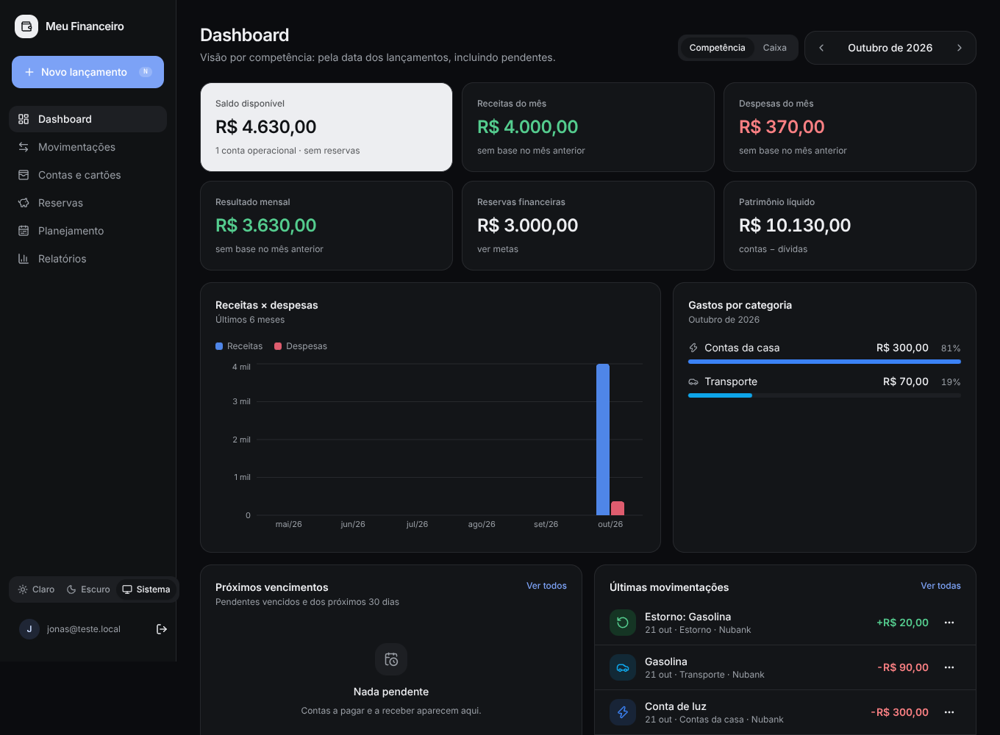

# Meu Financeiro

Gerenciador de finanças pessoais — privado, de um único usuário, feito para registrar um gasto em poucos segundos e acompanhar contas, reservas e patrimônio por anos.

**Stack:** Next.js 16 (App Router) · React 19 · TypeScript · Tailwind CSS 4 · componentes no padrão shadcn/ui (Radix) · Lucide · Recharts · Supabase (Postgres + Auth + RLS) · React Hook Form · Zod · date-fns · Vitest.



---

## Status: Fase 1 (MVP) concluída

| Critério de entrega (seção 19) | Status |
|---|---|
| 1. Entrar com login | ✅ |
| 2. Cadastrar contas e saldos iniciais | ✅ |
| 3. Registrar uma receita | ✅ |
| 4. Registrar uma despesa | ✅ |
| 5. Transferir dinheiro entre contas | ✅ |
| 6. Criar uma reserva financeira | ✅ |
| 7. Registrar um aporte nessa reserva | ✅ |
| 8. Consultar o dashboard | ✅ |
| 9. Navegar entre meses | ✅ |
| 10. Fechar o navegador, voltar e encontrar os dados | ✅ |

Os 10 critérios foram validados por um teste automatizado de ponta a ponta (`tests/e2e/acceptance.mjs`) rodando o app real contra **Supabase Auth (GoTrue) + PostgREST + PostgreSQL 16 reais**, além do celular (390 px).

**Também entregue:**

- Lançamentos: editar, excluir, duplicar, pesquisar, filtrar, marcar como pago/recebido, cancelar e registrar estorno.
- Conciliação de saldo com justificativa e histórico.
- Regime **competência × caixa** no dashboard e nos relatórios.
- Relatório de histórico mensal (12 meses, taxa de poupança, média de despesas).
- Visão de contas a pagar e a receber em 7, 15 e 30 dias.
- Exportação JSON (backup completo) e CSV, mais um script de restauração testado.
- Modo claro/escuro, layout responsivo com navegação inferior no celular e atalho **N** para novo lançamento.

**Fases seguintes:**

- **Fase 2:** cartões de crédito, parcelamentos, recorrências, orçamentos.
- **Fase 3:** relatórios avançados, insights, lançamento por linguagem natural, importação CSV.

As regras de cartão já estão definidas em [`docs/regras-financeiras.md`](docs/regras-financeiras.md).

---

## Colocar no ar (≈ 15 minutos)

### 1. Criar o projeto no Supabase

1. Crie um projeto em [supabase.com](https://supabase.com). Para os dados ficarem perto de você, escolha a região de São Paulo.
2. **Aplique a migração.** Abra o **SQL Editor**, cole o conteúdo de `supabase/migrations/20261021000001_fase1_schema.sql` e execute.
   - Alternativa com a CLI: `npx supabase link --project-ref <ref>` e depois `npx supabase db push`.
3. **Desative cadastros públicos.** Em *Authentication*, nas configurações de cadastro, desligue a opção que permite novos usuários se cadastrarem. Este app não tem tela de cadastro, mas a API de cadastro do Supabase continua aberta se você não desligar.
4. **Crie o seu usuário.** Em *Authentication → Users → Add user*, use e-mail e senha forte e marque a confirmação automática.

### 2. Rodar localmente

```bash
cp .env.example .env.local   # preencha a URL e a chave pública (publishable/anon) do projeto
npm install
npm run dev                  # http://localhost:3000
```

Só a **chave pública** vai para o app. A chave secreta (service role) **nunca** é usada pelo app. Ela serve apenas para o script de restauração, executado na sua máquina.

### 3. Publicar (Vercel)

1. Suba o código para um repositório privado no GitHub e importe o projeto na Vercel.
2. Configure as variáveis `NEXT_PUBLIC_SUPABASE_URL` e `NEXT_PUBLIC_SUPABASE_PUBLISHABLE_KEY` (ou `NEXT_PUBLIC_SUPABASE_ANON_KEY` em projetos antigos).
3. No Supabase, em *Authentication → URL Configuration*, coloque a URL da Vercel como *Site URL*.

No primeiro acesso, as categorias padrão são criadas automaticamente. Depois cadastre suas contas com o saldo de hoje.

---

## Regras financeiras

O documento completo, com exemplos, está em [`docs/regras-financeiras.md`](docs/regras-financeiras.md). Em resumo:

- **Saldo** = saldo inicial + movimentações **efetivadas**. Ele nunca é armazenado, sempre recalculado.
- **Pendente não altera saldo.** **Transferência não é receita nem despesa.**
- **Competência** usa a data do lançamento, incluindo pendentes. **Caixa** usa a data em que foi efetivamente pago.
- **Estorno** abate a despesa original, na mesma categoria.
- **Reserva é uma etiqueta sobre o saldo de uma conta**, não dinheiro novo:
  - Disponível = contas operacionais − reservado.
  - Patrimônio = contas − dívidas. As reservas já estão dentro dos saldos e nunca são somadas duas vezes.

---

## Segurança

- **Row Level Security** em todas as tabelas, com política `user_id = auth.uid()`. O papel anônimo não tem acesso a nada.
- **Integridade por dono no banco.** FKs compostas `(id, user_id)` impedem que um lançamento aponte para a conta de outro usuário, mesmo que alguém burle a interface.
- **Regras críticas no próprio Postgres**, por CHECKs e triggers, valendo para qualquer cliente:
  - estorno ≤ despesa original;
  - aporte ≤ saldo livre;
  - reserva nunca negativa;
  - categoria compatível com o tipo do lançamento;
  - `pago` ⇔ data de pagamento preenchida.
- **Validação dupla.** Toda gravação passa por Server Actions validadas com Zod no servidor, e a sessão é verificada no servidor do Supabase (`getUser`).
- **Proteção de rotas.** O proxy (`src/proxy.ts`) renova a sessão e redireciona quem não está logado. A API de exportação responde 401 sem sessão.
- **Cabeçalhos de segurança:** `X-Frame-Options: DENY`, `nosniff`, HSTS e `Referrer-Policy`.
- **CSV protegido** contra injeção de fórmulas. Nenhuma senha bancária é armazenada.

## Backup e recuperação

1. **Backup:** em *Configurações → Exportar dados → Backup completo (JSON)*. Faça uma vez por mês e guarde em local seguro.
   - Verifique também, no painel do Supabase, que backups automáticos o seu plano inclui.
   - Para um dump SQL completo: `npx supabase db dump --data-only > backup.sql`.
2. **Restaurar** (projeto novo ou após perda de dados):
   1. Aplique a migração no projeto de destino.
   2. Crie o usuário e copie o ID dele em *Authentication → Users*.
   3. Rode, na sua máquina:

      ```bash
      SUPABASE_URL=https://xxx.supabase.co \
      SUPABASE_SERVICE_ROLE_KEY=... \
      RESTORE_USER_ID=<id do usuário> \
      node scripts/restore-backup.mjs meu-financeiro-backup-AAAA-MM-DD.json
      ```

   O procedimento foi testado: exportar, apagar tudo e restaurar resultou em saldos e reservas idênticos.

---

## Testes

```bash
npm test            # unitários + banco (57 testes)
npm run typecheck
npm run build
```

| Suíte | O que cobre |
|---|---|
| `tests/unit` (36) | Centavos e parsing de "1.234,56"; datas no fuso de São Paulo, meses e anos bissextos; competência × caixa; estornos; nenhum lançamento contado em dois meses; disponível, reservas e patrimônio sem dupla contagem; progresso e aporte sugerido. |
| `tests/db` (21) | **As mesmas migrações de produção** num Postgres embarcado (PGlite): saldos, pendentes, data de pagamento, saldo inicial, edição e exclusão, transferências, constraints, estornos, conciliação, regras de reserva e **isolamento entre usuários via RLS**. |
| `tests/e2e` (14 etapas) | Os 10 critérios de entrega no navegador, mais editar, duplicar, estornar, excluir, regime de caixa, exportação e uso no celular. |

O teste de ponta a ponta precisa de um usuário **sem dados**, num projeto Supabase **de testes, nunca o de produção**:

```bash
npx playwright install chromium
E2E_URL=http://localhost:3000 E2E_EMAIL=teste@exemplo.com E2E_PASSWORD=... npm run test:e2e
```

---

## Estrutura

```
supabase/migrations/   schema, RLS, triggers e função de saldos (versionado)
src/lib/finance/       regras financeiras puras e testáveis (dinheiro, datas, resumos, reservas)
src/lib/data/          consultas ao Supabase (somente servidor, paginadas)
src/lib/actions/       Server Actions (validação Zod + gravação)
src/lib/validation.ts  schemas compartilhados entre formulário e servidor
src/app/(app)/         telas: dashboard, movimentações, contas, reservas, planejamento, relatórios, configurações
src/components/        UI (shadcn-style), shell/navegação, formulários de lançamento, gráficos
docs/                  regras financeiras e capturas de tela
scripts/               restauração de backup
tests/                 unit, db (Postgres embarcado) e e2e
```
